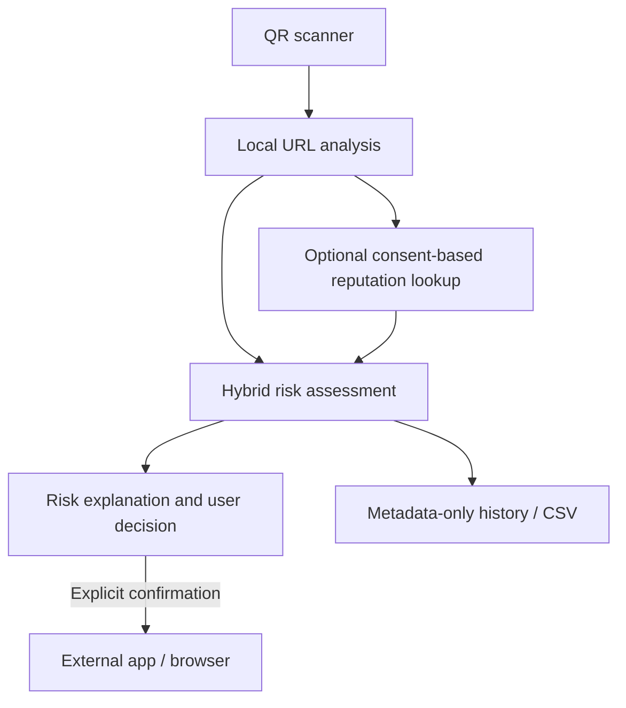

# QR Security Gateway (QRSG)

**Scan the code, not the risk.**

QRSG is an Android research prototype that inspects QR-encoded HTTP/HTTPS URLs before the user decides whether to open them. It combines offline URL heuristics and optional online reputation checks. It is an additional warning layer, not a guarantee of safety or a system-wide URL blocker.

[](https://github.com/readingdragon/QR-security-gateway/actions/workflows/android-ci.yml)
[](https://github.com/readingdragon/QR-security-gateway/actions/workflows/codeql.yml)
[](https://github.com/readingdragon/QR-security-gateway/actions/workflows/secrets.yml)

## Features and architecture

| Level | Implementation | Purpose |
| --- | --- | --- |
| 1 | `UrlParser`, `LocalUrlAnalyzer`, `HeuristicRules` | Offline validation and 15 deterministic URL indicators |
| 2 | `ReputationProvider`, `SafeBrowsingV5Provider` | Optional Google Safe Browsing v5 lookup (with consent) |
| 3 | `HybridRiskEngine` | Combines local indicators and known-threat results |
| 4 | `ScanRecordMapper`, Room, history repository | Metadata-only history, statistics and CSV export |

CameraX + Google ML Kit decode QR codes; Jetpack Compose presents the result. A scanned link is never opened automatically. The actual parsed host and URL are displayed before explicit confirmation to hand the link to another Android app.



| Final status | Meaning |
| --- | --- |
| `HIGH_RISK` | Google reported a known threat. Do not open the link. |
| `SUSPICIOUS` | At least one local indicator was detected. Independently verify the destination. |
| `LOW_RISK` | No local indicators or known-threat matches were detected. This does **not** mean safe. |
| `UNVERIFIED` | Insufficient evidence, unsupported content, or missing reputation result. |

## Build and test

Requirements: JDK 17, Android SDK Platform 36, Android SDK Build Tools, and the checked-in Gradle Wrapper (Gradle 9.1.0). Minimum Android version: API 26 (Android 8.0). Compile/target SDK: 36.

```bash
git clone https://github.com/readingdragon/QR-security-gateway.git
cd QR-security-gateway
export ANDROID_HOME="$HOME/Android/Sdk"
./gradlew :app:testDebugUnitTest :app:lintDebug :app:assembleDebug
```

The debug APK is generated at `app/build/outputs/apk/debug/app-debug.apk`. Install only on a device you control:

```bash
adb install -r app/build/outputs/apk/debug/app-debug.apk
```

No API key is needed for offline operation or ordinary unit tests. If KSP's generated cache becomes inconsistent, stop Gradle, remove `app/build/kspCaches` and `app/build/generated/ksp`, then retry with `-Pksp.incremental=false`.

### Optional online reputation

Enable the Safe Browsing API in your Google Cloud project and configure a restricted key for your own application. The API is intended for non-commercial use; see [Google's terms](https://developers.google.com/safe-browsing/terms). For commercial deployment, evaluate a suitably licensed provider such as Web Risk.

```bash
read -rsp 'Safe Browsing API key: ' QRSG_SAFE_BROWSING_API_KEY; echo
export QRSG_SAFE_BROWSING_API_KEY
./gradlew :app:assembleDebug --no-configuration-cache --no-build-cache
unset QRSG_SAFE_BROWSING_API_KEY
```

The build also supports a Gradle property of the same name; never put a real key in the repository's `gradle.properties`. Keys embedded in BuildConfig/APKs are extractable. Restrict the key to the required API and appropriate application identity, enforce quota limits and rotate it if exposed. Do not publish a key-bearing APK or build cache. CI deliberately builds without a key.

## Privacy and limitations

- The local analyzer does not resolve DNS, fetch websites, execute page content or follow redirects.
- Online reputation is optional and requires explicit consent. The full URL (path and query included, fragment removed) may be sent to Google. Do not submit private tokens or confidential links. Local/private destination checks are heuristic and do not resolve DNS.
- Persisted history contains scan metadata, not the raw QR payload, URL or hostname. History is stored in app-private Room storage; this is not a claim of database encryption or guaranteed forensic erasure. CSV export creates a separate user-controlled file.
- Opening a link is user-initiated; the receiving app may follow redirects. Even a known-threat warning can be overridden. QRSG does not inspect page contents or prevent all attacks.

## Secure development and SBOM

GitHub Actions configuration provides build/unit tests/Android Lint, CodeQL (Java/Kotlin), Gitleaks, and CycloneDX generation with Trivy dependency scanning. Dependabot proposes Gradle and Actions updates. A configured workflow is not evidence that its checks passed; see the [Actions tab](https://github.com/readingdragon/QR-security-gateway/actions).

Generate the resolved Android release runtime dependency SBOM:

```bash
./gradlew :app:cyclonedxDirectBom --no-configuration-cache
```

Output: `app/build/reports/cyclonedx-direct/bom.json` and `bom.xml`. The Android CI workflow uploads these as artifacts and scans the JSON SBOM. See [SBOM scope and generation](docs/SBOM.md). The source-declared inventory under `sbom/` is explicitly incomplete and must not replace the resolved SBOM.

Report security issues privately; see [SECURITY.md](SECURITY.md). License: [MIT](LICENSE).
